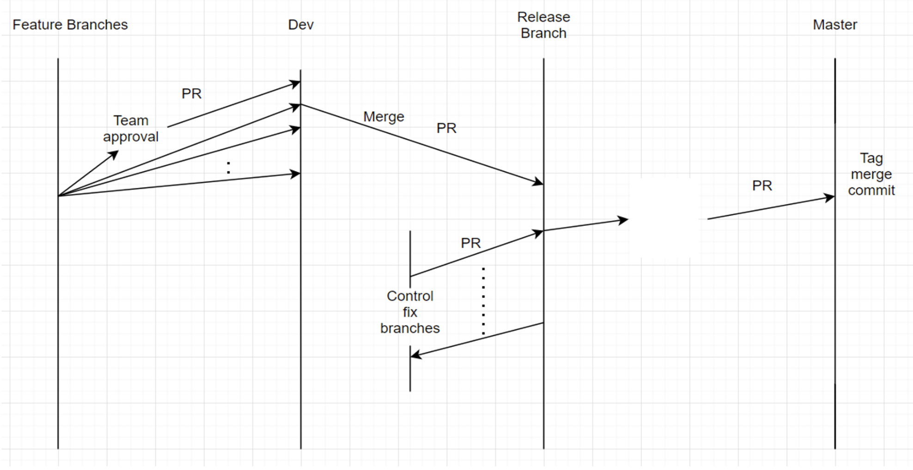

# Release Process & Automations

## 1. Branching Strategy & Release Process

### Branch Types
* **Master Branch:** Contains the stable production code. Merges to this branch are deployed straight to **Production**.
* **Release Branch:** Used for final testing and stabilization. Merges to this branch are deployed to **Pre-Production**.
* **Develop Branch:** The main integration branch. Feature branches are merged here, triggering deployments to the **Dev environment**.
* **Feature Branches:** Used for active feature development. Each developer creates their own dedicated feature branch to make code updates.

### The Release Lifecycle
1. **Release Start:** At the beginning of every release cycle, a new release branch is cut from the **Master** branch.
2. **Feature Development:** Developers work on individual feature branches and open Pull Requests (PRs) to merge their completed features into **Develop**.
3. **End of Cycle:** At the end of the 2-week release cycle, a new deployment branch is created out of **Dev**, and a PR is opened to merge it into the **Release** branch. This deploys the code to **Pre-Prod**.
4. **Production Deployment:** A PR is then created to merge the **Release** branch into **Master**. Once merged, the code is deployed live to **Production**.
5. **Tagging:** The release is officially tagged in git for version tracking.

---

## 2. Automations & CI/CD Pipeline

Controls testing is fully automated by building a Continuous Integration (CI) test suite within **Azure DevOps**.

### Feature Branch Lifecycle & PR Validation
* Active development of controls takes place directly on the **Feature branch**.
* Developers write integration tests and perform **local testing** before raising a PR.
* Once a PR is opened to merge the Feature branch into the **Develop branch**, the automated **PR Validation Tests** kick off:
    * **Good Terraform Check:** 
        * Automatically creates compliant ("good") Terraform resources.
        * Runs all security and governance controls.
        * Destroys the provisioned resources.
    * **Bad Terraform Check:** 
        * Automatically creates non-compliant ("bad") Terraform resources.
        * Runs all security and governance controls.
        * Destroys the provisioned resources.
    * **Pass/Fail Criteria:** The PR validation passes *only* if the controls successfully pass for the good Terraform resources **and** correctly catch/fail for the bad Terraform resources.

### Environment Deployments (Dev, Pre-Prod, & Prod)

When code successfully merges into **Develop**, **Release**, or **Master**, the corresponding CI/CD pipeline triggers automated steps for that specific environment:

#### 1. Merge into Develop Branch (Dev Environment)
* **CI Pipeline:** Kicks in automatically to run the comprehensive integration test suite.
* **CD Pipeline:** Automatically deploys to the **Dev environment** by executing:
    * Docker image build
    * Docker image push to the registry
    * `kubectl apply` to update the cluster

#### 2. Merge into Release Branch (Pre-Prod Environment)
* **CI Pipeline:** Kicks in automatically to run the comprehensive integration test suite.
* **CD Pipeline:** Automatically deploys to the **Pre-Prod environment** by executing:
    * Docker image build
    * Docker image push to the registry
    * `kubectl apply` to update the cluster

#### 3. Merge into Master Branch (Prod Environment)
* **CI Pipeline:** Kicks in automatically to run the comprehensive integration test suite.
* **CD Pipeline:** Automatically deploys to the **Prod environment** by executing:
    * Docker image build
    * Docker image push to the registry
    * `kubectl apply` to update the cluster
