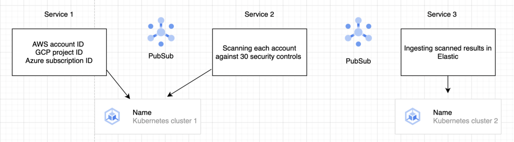

# Project Architecture & System Documentation

This document outlines the Kubernetes cluster architecture, multi-cloud automated scanning workflow, observability setup, and real-world production incident resolutions.

---

## 1. Project Architecture

The system operates across a multi-cloud environment utilizing Google Cloud Platform (GCP) for core orchestration, AWS/Azure/GCP for target scanning, and an asynchronous, event-driven architecture.

### Infrastructure Summary
* **Orchestration:** Two Kubernetes clusters deployed natively in **GCP**.
* **Language Runtime:** All core services are written in **Python**.
* **Cluster Layout:**
  * **Cluster 1:** Runs `Service 1` and `Service 2`.
  * **Cluster 2:** Runs `Service 3` and hosts the configured **Elasticsearch** instance.

### End-to-End Workflow & Services

#### Trigger Mechanism
Three dedicated **Cron Jobs** are configured (one for each major provider: AWS, Azure, and GCP). These jobs trigger automatically **once every day**. When a cron job fires, it kicks off `Service 1`, initiating the global automation workflow.

#### Service 1: Discovery Engine
* **Role:** Fetches organizational cloud identity metadata.
* **Mechanisms:**
  * **AWS:** Queries the AWS Organizations API to discover active Account IDs.
  * **GCP:** Queries the GCP Organization resource to fetch Project IDs.
  * **Azure:** Queries Azure Tenants to obtain valid Subscription IDs.
* **Output:** Publishes all discovered account metadata into **PubSub 1**.

#### Service 2: Compliance Scanner
* **Role:** Acts as the processing engine subscribing to **PubSub 1**.
* **Mechanisms:** Extracts the account/project/subscription IDs one by one, logs into the respective cloud environment dynamically, and evaluates the active infrastructure against **200 security controls**.
* **Output:** Publishes raw evaluation findings and scan results into **PubSub 2**.

#### Service 3: Ingestion & Storage Engine
* **Role:** Subscribes to **PubSub 2** inside Cluster 2.
* **Mechanisms:** Processes incoming data records one by one and ingests them straight into **Elasticsearch**.
* **Output:** Storage layer optimized for long-term telemetry retention and indexed for visualization.

---

## 2. Telemetry & Observability

### System & Infrastructure Metrics
* **Cluster Health Monitoring:** Memory utilization tracked continuously across both Kubernetes clusters. If usage spikes above **85%**, a critical notification alert fires directly into our engineering Slack channel. This integration is handled via GCP Monitoring and Alerting.
* **Automation Auditing:** Real-time dashboards track the exact execution status and failures of the daily cloud Cron Jobs.

### Elasticsearch & Kibana Dashboard Metrics
The system retains **7 months of historical compliance data** within Elasticsearch. A centralized Kibana dashboard tracks:
* Number of cloud accounts scanned per cloud provider.
* Total error volume.
* Total number of alert events.
* Total number of passed security checks.
* **Global Compliance Rate**.
* **SLA Violations:** Defined strictly as **High** severity alerts older than 3 months, and **Medium** severity alerts older than 6 months.

#### Tracked Failure Modes
* **HTTP 429:** High-frequency API throttling events.
* **Permission Denied:** Identity and Access Management (IAM) restrictions blocking specific resource visibility.
* **Slack Alert Thresholds:** Automated alerts trigger if tracking metrics slip unexpectedly. For example, if the aggregate number of cloud accounts scanned drops by more than **5%**, an immediate alert is dispatched to Slack.

---

## 3. Automation Extensions

### Mailer Service
To ensure decentralized remediation, every scanned cloud environment is mapped to an assigned security owner.
* **Mechanisms:** If active security alerts are detected inside an account, the automated **Mailer Service** references the metadata mapping to locate the environment's **Security Owner**.
* **Action:** Dispatches an automated email compilation containing all active vulnerabilities requiring manual action.

---

## 4. Production Cases & Resolutions

### Case 1: Infrastructure Scale vs. API Throttling (HTTP 429)
* **Context:** The system scans thousands of cloud accounts containing millions of unique resources across AWS, Azure, GCP, and Alibaba Cloud against 200 controls. Every control performs API requests to fetch resource traits (e.g., assessing if an AWS S3 bucket lacks server-side encryption configurations). 
* **The Problem:** Massive concurrent scanning led to immediate API rate limits being hit at the subscription/tenant levels for Azure Storage Accounts, GCP Firewall rules, and AWS EBS volumes. Increasing vendor quotas provided only temporary relief as scope expanded exponentially.

#### Applied Resolutions
1. **Control Code Optimization:** Re-architected the scanning workflow to query all Azure Storage accounts once, cache the complete API response object in memory, and execute the multiple storage-related controls against the local cache rather than querying Azure repeatedly.
2. **Backend Multi-Threading:** Modified the backend scanning engine (based on the Chef InSpec open-source architecture found in the [InSpec AWS Library](https://github.com/inspec/inspec-aws/tree/main/libraries)). The baseline framework executed one individual API call per cloud resource. We rewrote this to leverage multi-threading, compressing queries down to **one single API call for 'n' number of resources**.

### Case 2: Message Broker Deadlock (PubSub Failure)
* **The Problem:** `Service 1` triggered normally according to schedule, but an underlying disruption occurred within the GCP PubSub middleware layer. As a result, discovered cloud account payloads failed to publish to the topic.
* **Impact:** Because messages never arrived on **PubSub 1**, the downstream component (`Service 2`) failed to pick up any scanning tasks. The orchestration died silently mid-stream, resulting in an unsuccessful daily compliance scan.
* **Resolution:** Implemented advanced health checks on the PubSub publisher acknowledgment patterns to alert on zero-message publishing trends during Cron Job runs.